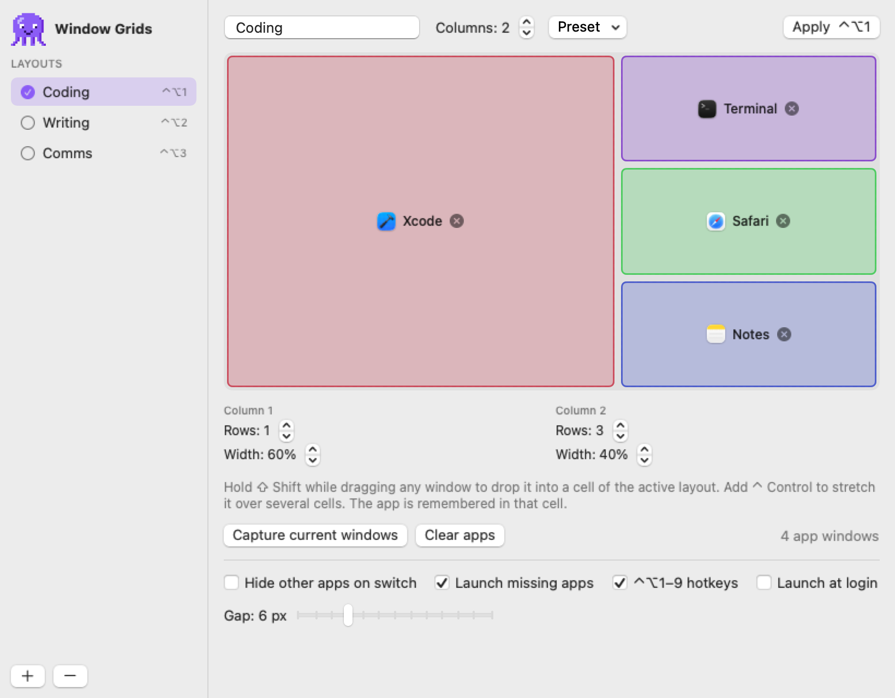
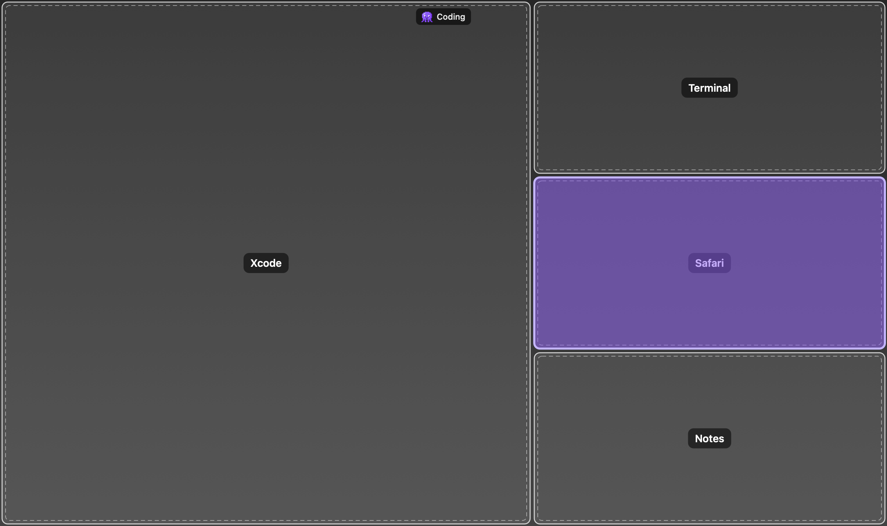

# Window Grids

A small macOS menu bar app that arranges app windows on a grid, remembers which app goes in which cell, and switches between saved arrangements with a hotkey.

<p>
  
</p>

## How it works

- **Layouts**: a layout is a named grid plus the apps placed in its cells. Make as many as you like in the editor (menu bar icon → *Edit Layouts…*).
- **Flexible grids**: a grid is a row of columns, and every column has its own width and its own number of rows. One half-width column next to a column of three rows, a wide main area with a narrow stack beside it, or a plain 3 × 2 are all the same thing with different numbers. The *Preset* menu has the common ones.
- **Drag a window into the grid**: hold **⇧ Shift** while dragging any window. The grid of the active layout appears; drop on a cell and the window snaps to it. The app is remembered in that cell. Add **⌃ Control** while dragging to stretch the window over several cells.
- **Switch layouts**: **⌃⌥1 … ⌃⌥9** or the menu bar menu. Every app in the layout moves to its cells; apps that are not running are launched. Optionally, apps not in the layout are hidden.
- **Capture**: *Capture current windows* snaps every visible window to its nearest cells and stores the result in the layout.

<p>
  
</p>

Layouts are stored in `~/Library/Application Support/WindowGrids/layouts.json`.

## Build and install

Requires Xcode command line tools (Swift 5.9+) and macOS 14+.

```sh
./scripts/build-app.sh --install   # builds, copies to /Applications, launches
```

On first launch macOS asks for **Accessibility** access (System Settings → Privacy & Security → Accessibility). The app cannot move other apps' windows without it.

macOS ties that permission to the code signature. The build script signs with an Apple Development or Developer ID certificate if one is in the keychain, so the permission survives rebuilds. Without one it signs ad-hoc and the permission has to be granted again after each build.

## Notes

- Windows that enforce a minimum or fixed size will not shrink to a small cell.
- With several windows of one app, each assigned cell takes the window already closest to it.
- Multiple displays: the grid is shown on every display, and each assignment remembers its display.

## Debugging

```sh
WindowGrids --selftest                 # check the grid maths
WindowGrids --render editor.png        # render the editor with example data
WindowGrids --render-overlay grid.png  # render the drag overlay with example data
```

The octopus is pixel art defined in `Sources/WindowGrids/Mascot.swift`; `./scripts/make-icon.sh` regenerates the app icon from it.

## License

[MIT](LICENSE)
